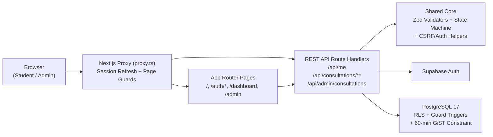
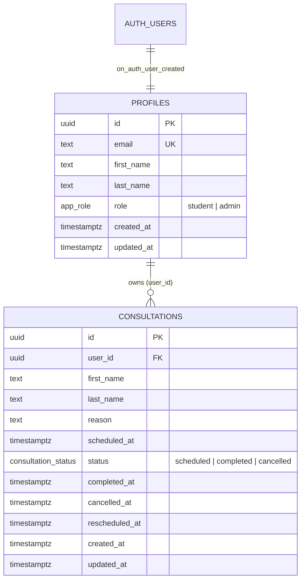

# Contour Mini-LMS

## 1. Project Tech Stack

- **Framework**: Next.js 16 (App Router, Turbopack, `proxy.ts`)
- **Language**: TypeScript (strict mode)
- **Database & Auth**: Supabase (`@supabase/supabase-js`, `@supabase/ssr`, PostgreSQL 17, Row-Level Security)
- **Validation**: Zod v4
- **UI**: Tailwind CSS + shadcn/ui (Radix UI primitives + Lucide icons)
- **Testing**: Vitest

---

## 2. Local Development Setup

### Prerequisites
- **Node.js** v20+ and **npm**
- **Docker Desktop** *(Local Supabase)*

### Step 1:  Install Dependencies
```bash
npm install
```

---

### Step 2: Setup Local Supabase (Docker + Supabase CLI)

The Supabase CLI is pinned as a `devDependency` in `package.json`, so no global CLI install is required.

1. Ensure **Docker Desktop** is running.
2. Start the local Supabase stack (PostgreSQL, Auth, PostgREST, Studio, Mailpit). On first run, it automatically applies `supabase/migrations/*.sql` and seeds `supabase/seed.sql`:
   ```bash
   npm run db:start
   ```
3. Copy `.env.example` to `.env.local`:
   ```bash
   cp .env.example .env.local
   ```
4. Set `NEXT_PUBLIC_SUPABASE_URL` and `NEXT_PUBLIC_SUPABASE_PUBLISHABLE_KEY` in `.env.local` using the `API_URL` (`http://127.0.0.1:54321`) `PUBLISHABLE_KEY` printed by `npm run db:start` 

   Run this command to get the publishable key if forgot:
   ```bash
   npm run db:status
   ```
   Example .env.local
   ```env
   NEXT_PUBLIC_SUPABASE_URL=http://127.0.0.1:54321
   NEXT_PUBLIC_SUPABASE_PUBLISHABLE_KEY=<publishable-key-from-db-status>
   ```
   > Local Supabase keys are deterministic across restarts — you only need to configure `.env.local` once.
5. Start the Next.js development server:
   ```bash
   npm run dev
   ```
6. Open the app and local tools:
   - **App**: http://localhost:3000
   - **Supabase Studio**: http://127.0.0.1:54323
   - **Mailpit (local email inbox)**: http://127.0.0.1:54324

---


### Development npm Scripts

| Command | Description |
| :--- | :--- |
| `npm run dev` | Start Next.js development server on http://localhost:3000 |
| `npm run build` | Build production bundle (`next build`) |
| `npm run start` | Start production server |
| `npm run typecheck` | Run TypeScript strict type-checking (`tsc --noEmit`) |
| `npm run lint` | Run ESLint across the repository |
| `npm test` | Run automated Vitest unit & API security/RBAC test suites |
| `npm run test:watch` | Run Vitest in watch mode |
| `npm run test:db` | Run pgTAP database tests in `supabase/tests/` (exclusion constraint, guard trigger, RLS/RBAC); requires local Supabase running |
| `npm run db:start` | Start local Supabase Docker stack |
| `npm run db:stop` | Stop local Supabase Docker stack |
| `npm run db:status` | Print local Supabase URLs and API keys |
| `npm run db:reset` | Recreate local DB, re-run migrations, and reload `supabase/seed.sql` |

---

## 3. Testing Instructions & Demo Accounts

### Automated Test & Quality Checks
```bash
npm run typecheck
npm run lint
npm test
npm run test:db   # requires `npm run db:start`; each test file runs in a rolled-back transaction
npm run build
```

### Local Seeded Demo Accounts
Running `npm run db:start` or `npm run db:reset` seeds 3 pre-confirmed accounts (all with password **`Password123!`**) and 6 sample consultations across `scheduled`, `completed`, `cancelled`, and rescheduled states:

| Role | Email | Password | Landing View |
| :--- | :--- | :--- | :--- |
| **Admin** | `admin@contour-lms.local` | `Password123!` | `/admin` (Read-only view of all 6 consultations) |
| **Student** | `alice@contour-lms.local` | `Password123!` | `/dashboard` (4 personal consultations) |
| **Student** | `bob@contour-lms.local` | `Password123!` | `/dashboard` (2 personal consultations) |

### Create new Admin account (if needed)
New sign-ups are always assigned the `student` role by the database trigger (preventing client-side privilege escalation). To promote a user to `admin`, update the role type via **Table Editor** in local supabase studio or run following statement in the **SQL Editor**:

```sql
update public.profiles
set role = 'admin'
where email = 'your-admin@example.com';
```

### Suggested Manual End-to-End Test Flow
1. **Student Flow** (log in as `alice@contour-lms.local` or sign up as a new student):
   - Book a future consultation (verify First & Last Name are prefilled from profile).
   - Attempt to book another consultation within 60 minutes of an active one → verify `409` conflict message.
   - Click **Mark Complete** / **Mark Incomplete** → verify status badge and KPI counts update.
   - **Reschedule** an upcoming consultation → verify new time and `Rescheduled ...` audit timestamp appear.
   - **Cancel** an upcoming consultation → confirm modal, verify status turns `Cancelled` and edit/complete controls lock.
   - Visit `/admin` directly → verify `403 Access Denied` screen.
2. **Admin Flow** (log in as `admin@contour-lms.local`):
   - Verify automatic routing to `/admin` and navbar shows **Admin Console** only.
   - Verify consultations across both Alice and Bob are displayed with student account emails, filters, search (by name, email, or reason), sort, and pagination.
   - Visit `/dashboard` directly → verify redirect back to `/admin`.

---

## 4. Overall Implementation Summary & Architecture

### Key Assumptions
1. **Students sign up with First Name & Last Name, and consultation booking locks those names to the user's profile (UI, API, and DB trigger).**
   - **Why for this assessment:** Keeps student identity consistent across bookings, avoids name spoofing via direct API/PostgREST calls, and satisfies the booking form's First/Last Name requirement without adding a separate profile-settings flow.
   - **In a production LMS:** Provide a dedicated Account/Profile settings page (`PATCH /api/me`) allowing students to update their display name (or sync from an institutional SSO/IdP like SAML/OIDC) while recording historical snapshots on past consultations.
2. **Each active consultation reserves a fixed 60-minute window per student (`[scheduled_at, scheduled_at + 60m)`), without modeling tutors or rooms.**
   - **Why for this assessment:** The prompt requires only attendee name, reason, and datetime; a fixed 60-minute PostgreSQL GiST exclusion constraint cleanly demonstrates race-condition-free overlap prevention without over-modeling unrequested entities.
   - **In a production LMS:** Model tutors, rooms/video links, working-hour availability blocks, configurable session durations (e.g., 30/45/60 min), and buffer times with exclusion constraints enforced per tutor as well as per student.
3. **New bookings and reschedules require a future datetime (`scheduled_at > now()`), while any non-cancelled consultation can be toggled between complete and incomplete.**
   - **Why for this assessment:** Prevents nonsensical past bookings while ensuring reviewers can immediately test the required Complete/Incomplete toggle on newly booked upcoming consultations (and lets students mark resolved questions early).
   - **In a production LMS:** Gate completion until after `scheduled_at` (or require tutor attendance sign-off), enforce a cutoff window for late reschedules/cancellations (e.g., at least 2 hours before start), and automatically mark unattended past sessions as `no_show`.
4. **Completed consultations cannot be cancelled directly (must be marked incomplete first), and cancelled consultations are soft-cancelled and immutable.**
   - **Why for this assessment:** Prevents contradictory states (both completed and cancelled) and preserves full audit visibility for both students and the Admin view without needing a separate audit-log table.
   - **In a production LMS:** Append every booking, reschedule, completion, and cancellation to an immutable `consultation_events` audit log table (preserving previous datetimes, actor IDs, and cancellation reasons) with configurable retention/re-booking workflows.
5. **Admins are strictly read-only observers across all student consultations and do not book personal consultations.**
   - **Why for this assessment:** Matches the prompt's note (*"Read-only is perfectly fine for the Admin view. We want to see how you define roles."*) and showcases clean, unambiguous role separation across UI, Route Handlers (`requireStudent` vs. `requireAdmin`), and Postgres RLS.
   - **In a production LMS:** Support granular RBAC permissions (e.g., `student`, `tutor`, `coordinator`, `admin`), admin/staff moderation actions (reassigning tutors, cancelling/rescheduling on a student's behalf), and an admin user-management UI instead of SQL-based role promotion.

### Core Capabilities
- **Authentication**: Sign up (capturing First Name, Last Name, Email, Password), login, logout, and password recovery powered by Supabase Auth (`@supabase/ssr`).
- **Student Dashboard (`/dashboard`)**:
  - View personal consultations with summary metrics, status filters (`All`, `Scheduled`, `Completed`, `Cancelled`), search, sorting (default: latest scheduled first), and pagination.
  - Book new consultations with First Name & Last Name automatically prefilled from the student's profile, future-datetime validation, and a 60-minute non-overlapping active slot rule.
  - Mark individual consultations as **Complete / Incomplete**.
  - **Reschedule** upcoming consultations (update datetime and/or reason) and **Cancel** consultations with confirmation (soft-cancel preserving audit history).
- **Admin Console (`/admin`)**:
  - Strictly separated read-only view for users with the `admin` role displaying all consultations across all students (with student account email, filters, search, sort, pagination, and system-wide stats).
  - Non-admin users are blocked at the page (`403 Access Denied`), API (`403 FORBIDDEN`), and database RLS layers.

### Architecture Overview
All domain reads and mutations flow through RESTful Next.js Route Handlers (`app/api/**`) rather than Server Actions, backed by shared validation, pure domain transition rules, and PostgreSQL Row-Level Security.



### Key Codebase Modules
- `supabase/migrations/20261121000001_initial_schema.sql` & `supabase/seed.sql` — schema, triggers, constraints, indexes, RLS, and local seed data.
- `lib/types/database.ts` — end-to-end TypeScript types wired into both server and browser Supabase clients.
- `lib/validators/consultation.ts` — Zod v4 schemas for request payloads, UUID params, and list query parameters.
- `lib/domain/` — framework-free consultation rules: `consultation-transitions.ts` (lifecycle state machine) and `consultation-constants.ts` (centralized `MIN_CONSULTATION_GAP_MINUTES`).
- `lib/auth/session.ts` — unified server-verified session & profile loader (`getCurrentSession` with React `cache()` for per-request deduplication across layouts and pages).
- `lib/api/` — shared API infrastructure: `auth.ts` (`requireAuth`, `requireStudent`, `requireAdmin`), `request.ts` (`parseJsonBody` with `Origin` + `Content-Type` validation), `response.ts` (standard JSON envelopes & error mapping), `consultations-query.ts` (pagination, safe search, summary counts), `redirect.ts` (open-redirect prevention).
- `app/api/**` — REST Route Handlers (`/api/me`, `/api/consultations`, `/api/consultations/[id]`, `/api/admin/consultations`).
- `app/(app)/`, `components/consultations/`, & `hooks/use-consultation-list.ts` — role-aware app shell, Student Dashboard, consultation dialogs, read-only Admin Console, and shared `AbortController`-backed list hook.

---

## 5. Database Schema, Migrations & Security Controls

Migration file: [`supabase/migrations/20261121000001_initial_schema.sql`](supabase/migrations/20261121000001_initial_schema.sql)



### Custom Types & Tables
- **`public.app_role`**: `ENUM ('student', 'admin')`
- **`public.consultation_status`**: `ENUM ('scheduled', 'completed', 'cancelled')`
- **`public.profiles`**: 1:1 with `auth.users` (`ON DELETE CASCADE`), storing `email` (`UNIQUE`), `first_name`, `last_name`, and `role` (default `'student'`).
- **`public.consultations`**: Stores consultation bookings with trimmed length constraints (`first_name`/`last_name` 1–100 chars, `reason` 1–1000 chars) and `CHECK` constraints keeping `completed_at` and `cancelled_at` strictly coupled to `status`.

### 60-Minute Non-Overlapping Booking Constraint (`EXCLUDE USING gist`)
- Uses PostgreSQL's `btree_gist` extension + an `IMMUTABLE` UTC-epoch helper `public.consultation_slot_range(scheduled_at)` returning the half-open interval `[scheduled_at, scheduled_at + 3600s)`.
- Partial exclusion constraint `no_overlapping_scheduled_consultations`:
  ```sql
  exclude using gist (
    user_id with =,
    public.consultation_slot_range(scheduled_at) with &&
  )
  where (status = 'scheduled')
  ```
- Atomically prevents a student from booking or rescheduling two active consultations less than **60 minutes (1 hour)** apart (race-condition-free). Cancelled and completed consultations do not block slots. Violations return SQLSTATE `23P01`, mapped by the API to `409 TIME_SLOT_CONFLICT`.

### Database Triggers
1. **`public.set_updated_at()`** (reusable global `BEFORE UPDATE` trigger on `profiles` and `consultations`): Automatically updates `updated_at = now()` whenever row data changes.
2. **`public.handle_new_user()`** (`AFTER INSERT ON auth.users`, `SECURITY DEFINER`): Provisions `public.profiles` with trimmed `first_name`/`last_name` from signup metadata and **hardcoded `role = 'student'`**.
3. **`public.handle_user_email_updated()`** (`AFTER UPDATE OF email ON auth.users`): Keeps `public.profiles.email` in sync if a user updates their auth email.
4. **`public.prevent_role_change()`** (`BEFORE UPDATE ON public.profiles`): Blocks any non-privileged session from altering `role`.
5. **`public.guard_consultation_write()`** (`BEFORE INSERT OR UPDATE ON public.consultations`): Defense-in-depth trigger blocking direct PostgREST tampering (enforces future `scheduled_at`, immutable `id`/`user_id`/`created_at`/`first_name`/`last_name`, state machine transitions, and server-stamped audit timestamps while bypassing for `postgres`/`service_role` migrations & seeds).

### Performance Indexes
- `idx_consultations_user_scheduled (user_id, scheduled_at DESC)` — Student dashboard listing
- `idx_consultations_user_status_scheduled (user_id, status, scheduled_at DESC)` — Student status tabs & summary counts
- `idx_consultations_status_scheduled (status, scheduled_at DESC)` — Admin status filtering & summary counts
- `idx_consultations_scheduled_at (scheduled_at DESC)` — Admin default chronological listing
- `idx_consultations_created_at (created_at DESC)` — Admin "Recently booked" sorting
- `idx_profiles_role (role)` — Role lookups

### Row-Level Security (RLS) & `public.is_admin()`
- `public.is_admin()` (`STABLE SECURITY DEFINER`, `SET search_path = ''`, execute granted only to `authenticated`/`service_role`) avoids recursive RLS evaluation on `profiles`.
- Policies use `(select auth.uid())` / `(select public.is_admin())` scalar subqueries for PostgreSQL `InitPlan` optimization and target `to authenticated` exclusively:
  - **`profiles`**: `SELECT` own row or all rows if Admin. No client `INSERT`/`UPDATE`/`DELETE`.
  - **`consultations`**:
    - `SELECT`: Owner (`user_id = auth.uid()`) or Admin.
    - `INSERT`: Authenticated non-admin (`user_id = auth.uid() AND NOT is_admin() AND status = 'scheduled'`).
    - `UPDATE`: Authenticated non-admin owner (`user_id = auth.uid() AND NOT is_admin()`).
    - `DELETE`: Disallowed (enforces soft-cancel auditability).

### Scalability Read View & Summary RPC (`SECURITY INVOKER`)
- **`public.consultations_with_student` (`WITH (security_invoker = true)`)**: Joins `consultations` with `profiles` so Admin search across `first_name`, `last_name`, `reason`, and `student_email` runs in a single query without pre-fetching/truncating profile IDs — while preserving caller RLS on both tables.
- **`public.get_consultation_summary(p_user_id uuid default null)` (`SECURITY INVOKER`)**: Computes `total`, `scheduled`, `completed`, and `cancelled` in a single `COUNT(*) FILTER (WHERE ...)` query (cutting every dashboard/admin list request to **2** DB round-trips total while enforcing RLS).

---

## 6. REST API Reference

All endpoints return consistent JSON envelopes:
- **Success**: `{ "data": ..., "meta"?: { "pagination": ..., "summary": ... } }`
- **Error**: `{ "error": { "code": "...", "message": "...", "details"?: ... } }`

| Endpoint | Method | Role / Guard | Query / Request Body | Success | Common Error Codes |
| :--- | :--- | :--- | :--- | :--- | :--- |
| `/api/me` | `GET` | Authenticated (`requireAuth`) | — | `200` Profile (`id`, `email`, `first_name`, `last_name`, `role`) | `401` |
| `/api/consultations` | `GET` | Student (`requireStudent`) | `?status=all\|scheduled\|completed\|cancelled&search=&sort=scheduled_at_desc\|scheduled_at_asc\|created_at_desc&page=1&pageSize=10` | `200` Own consultations + `meta.pagination` + `meta.summary` | `400`, `401`, `403` |
| `/api/consultations` | `POST` | Student (`requireStudent`) | `{ first_name, last_name, reason, scheduled_at }` (future ISO datetime) | `201` Created consultation | `400`, `401`, `403`, `409` (`TIME_SLOT_CONFLICT`), `415`, `422` |
| `/api/consultations/[id]` | `GET` | Owner or Admin (`requireAuth` + RLS) | UUID path param | `200` Consultation | `400`, `401`, `404` |
| `/api/consultations/[id]` | `PATCH` | Student Owner (`requireStudent`) | Discriminated union on `action`:<br>• `{ action: "reschedule", scheduled_at, reason? }`<br>• `{ action: "toggle_complete", completed: boolean }`<br>• `{ action: "cancel" }` | `200` Updated consultation | `400`, `401`, `403`, `404`, `409` (`INVALID_STATUS_TRANSITION`, `CONCURRENT_MODIFICATION`, `TIME_SLOT_CONFLICT`), `415`, `422` |
| `/api/admin/consultations` | `GET` | Admin (`requireAdmin`) | `?status=&search=&sort=&page=&pageSize=` *(search matches student name, email, and reason)* | `200` All consultations joined with `student` + `meta` | `400`, `401`, `403` |

---

## 7. Design Justifications

### Design & Security Justifications
- **REST API Route Handlers over Server Actions**: Keeps data access explicit, HTTP-semantic (`201`, `400`, `401`, `403`, `404`, `409`, `415`), reusable across web/mobile/external clients, and straightforward to test independently. `proxy.ts` excludes `/api/*` from login HTML redirects so unauthenticated API calls always receive `401` JSON.
- **Defense-in-Depth RBAC & Database Write Guard**:
  1. **Next.js Proxy** refreshes sessions and protects app routes.
  2. **API Route Handlers** verify sessions via `supabase.auth.getUser()` (server-verified against Supabase Auth, not just unverified cookies) and enforce `requireStudent()` / `requireAdmin()`.
  3. **PostgreSQL RLS + Triggers (`prevent_role_change`, `guard_consultation_write`)** prevent cross-tenant reads, role self-escalation, Admin writes, and direct PostgREST bypasses of business rules.
  - *Why `profiles.role` + `SECURITY DEFINER is_admin()` over Custom Access Token Auth Hooks?* Works identically out of the box on both local Supabase CLI and hosted Supabase Cloud with zero manual dashboard hook configuration, and reflects role changes immediately without waiting for JWT expiry.
- **Optimistic Concurrency Control (`PATCH /api/consultations/[id]`)**: Updates are scoped with `.eq("status", existing.status).eq("updated_at", existing.updated_at)`. If two concurrent requests (e.g., `cancel` + `complete` or simultaneous reschedules) race, Postgres's row-level locking ensures the stale write matches 0 rows atomically and returns `409 CONCURRENT_MODIFICATION`.
- **CSRF & Open-Redirect Hardening**:
  - Mutating Route Handlers (`POST`, `PATCH`) use `parseJsonBody()` to require `Content-Type: application/json` (`415` otherwise) and verify the `Origin` header matches the request host (`403` on mismatch), complementing `SameSite=Lax` cookies without stateful CSRF tokens.
  - `/auth/confirm` sanitizes the `next` query parameter via `getSafeRedirectPath()` using WHATWG `URL` origin verification (blocking `//evil.com`, `/\evil.com`, and external schemes).
- **`404` vs `403` on `/api/consultations/[id]`**: Returns `404 NOT_FOUND` when a student accesses another student's consultation UUID to prevent resource ID enumeration, while using `403 FORBIDDEN` on role-gated endpoints (`/api/admin/consultations`, student-only mutations).
- **Soft-Cancel Lifecycle**: Cancelling sets `status = 'cancelled'` + `cancelled_at` instead of deleting rows, preserving audit history for both students and administrators and preventing invalid dual states (such as being both completed and cancelled).


---

## 8. Future Improvements

### Business Logic Improvements
- **User Profile Management Page**: Allow students to update their own `first_name` / `last_name` (backed by a dedicated `PATCH /api/me` route and column-scoped RLS policy, while keeping `role` locked by `prevent_role_change()`).
- **Admin User Management & Invite-Only Admin Onboarding**: Add a User Management page in the Admin Console where admins can view student profiles and send single-use, time-limited invitation links via email to onboard new `admin` users securely — replacing manual SQL role promotion in the database.
- **Consultation Type & Automated Tutor Matching**: Include a Consultation Type / Subject dropdown in the booking form so requests can automatically match students with an appropriate available tutor/consultant when they do not select a specific one.
- **Tutor / Staff Scheduling & Completion Sign-Off**: Model instructors, working hours, and configurable consultation durations (with exclusion constraints per tutor as well as per student), and optionally gate completion until `scheduled_at <= now()` or tutor attendance confirmation.
- **Audit Log Table**: Record full reschedule/status-change history (`consultation_events`) rather than only the most recent `rescheduled_at` timestamp.
- **Email / Calendar Notifications**: Send confirmation, reminder, and cancellation notifications (and `.ics` calendar invites) on booking/reschedule/cancel events.


### Technical Improvements
- **Stronger Authentication Methods (Passwordless / Institutional SSO / MFA)**: Replace standalone email + password login with passwordless Email OTP / Magic Links or institutional SSO (SAML/OIDC) tied to verified school identities — or at minimum enforce multi-factor authentication (password + OTP/TOTP), especially for `admin` accounts.
- **JWT Role Claim Caching & Rate Limiting**: Add a Supabase Custom Access Token Hook to avoid per-request `profiles` lookups at high scale, and add Redis/Upstash rate limiting on auth and booking endpoints.
- **Playwright E2E Suite**: Add automated browser end-to-end tests running against ephemeral local Supabase instances in CI.


---

### If want to connect to Hosted Supabase Cloud

1. Create a project at https://supabase.com/dashboard.
2. Apply the database migration using **either** the Supabase CLI:
   ```bash
   npx supabase link --project-ref <your-project-ref>
   npx supabase db push
   ```
   **or** by pasting the contents of `supabase/migrations/20261121000001_initial_schema.sql` into **Supabase Dashboard → SQL Editor** and running it.
3. Copy `.env.example` to `.env.local` and populate values from **Project Settings → API**:
   ```env
   NEXT_PUBLIC_SUPABASE_URL=https://<your-project-ref>.supabase.co
   NEXT_PUBLIC_SUPABASE_PUBLISHABLE_KEY=<your-publishable-or-anon-key>
   ```
4. Configure **Authentication → URL Configuration** in Supabase Dashboard so `Site URL` is `http://localhost:3000` and `Redirect URLs` includes `http://localhost:3000/**`.
5. Run the development server:
   ```bash
   npm run dev
   ```

---

### Switching Between Local and Remote Supabase

1. Update `NEXT_PUBLIC_SUPABASE_URL` and `NEXT_PUBLIC_SUPABASE_PUBLISHABLE_KEY` in `.env.local` to point to either `http://127.0.0.1:54321` (local) or `https://<project-ref>.supabase.co` (remote).
2. Restart `npm run dev`.
3. Sign out or clear `localhost:3000` cookies so the browser does not send a JWT signed by the previous instance.