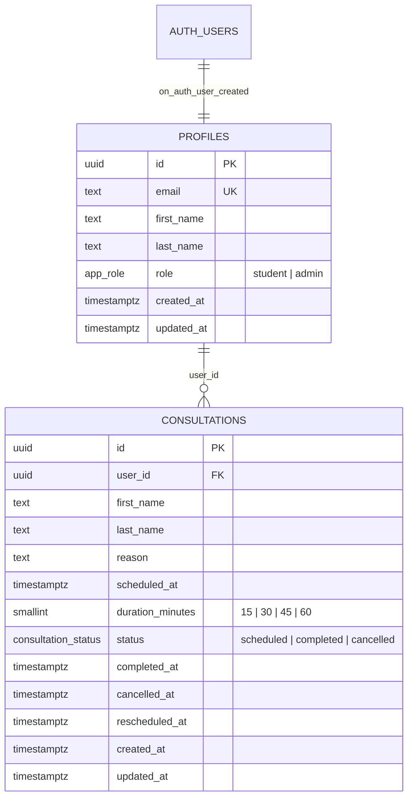

# Contour Mini-LMS

[](https://github.com/junyao-d/contour-mini-lms/actions/workflows/ci.yml)

A small consultation-booking LMS. Students sign up, book consultations, reschedule or cancel them, and mark them complete. Admins get a read-only view of every consultation in the system.

Stack: Next.js 16 (App Router), TypeScript, Supabase (Postgres 17, Auth, `supabase-js`, `@supabase/ssr`), Zod, Tailwind + shadcn/ui, `react-day-picker`, Vitest and pgTAP.

## Running locally

Prerequisites: Node.js 20.9+, npm, and Docker (for the local Supabase stack). The Supabase CLI is a dev dependency, so there is nothing to install globally.

```bash
npm install
npm run db:start              # starts Supabase in Docker, applies the migration and seed
cp .env.example .env.local
```

Fill in `.env.local` with the API URL and publishable key printed by `db:start` (run `npm run db:status` to see them again). Local keys don't change between restarts.

```env
NEXT_PUBLIC_SUPABASE_URL=http://127.0.0.1:54321
NEXT_PUBLIC_SUPABASE_PUBLISHABLE_KEY=<publishable key>
```

```bash
npm run dev                   # http://localhost:3000
```

Supabase Studio runs at http://127.0.0.1:54323. Email confirmation is off locally, so new sign-ups can log in straight away. `npm run db:reset` rebuilds the database from the migration and seed.

### Demo accounts

All seeded accounts use the password `Password123!`.

| Role | Email | Lands on |
| --- | --- | --- |
| Admin | `admin@contour-lms.local` | `/admin`, all 6 seeded consultations |
| Student | `alice@contour-lms.local` | `/dashboard`, 4 consultations |
| Student | `bob@contour-lms.local` | `/dashboard`, 2 consultations |

New sign-ups always get the `student` role. To make someone an admin, change their role in Studio's table editor or run `update public.profiles set role = 'admin' where email = '...';` in the SQL editor.

### Checks

```bash
npm run typecheck
npm run lint
npm test          # Vitest: validators, state machine, API route handlers (Supabase mocked)
npm run test:db   # pgTAP against the local database (needs db:start); each file rolls back
npm run build
```

CI (`.github/workflows/ci.yml`) runs all of these on every push: one job for the Node checks, and one that starts Supabase and runs the pgTAP tests.

### Hosted Supabase (optional)

Link a project and push the migration (`npx supabase link --project-ref <ref>` then `npx supabase db push`), or paste the migration into the SQL editor. Put the project URL and publishable key in `.env.local`. Set the Auth Site URL to `http://localhost:3000` and add `http://localhost:3000/**` to the redirect URLs. After switching between local and hosted, clear the `localhost:3000` cookies, because the old session's JWT won't verify against the new project.

## How it works

- **API first.** All consultation reads and writes go through Route Handlers in `app/api/**`, and there are no Server Actions. The server pages only check the session; the dashboard and admin views are client components that fetch from these endpoints. Sign-up, login and logout call Supabase Auth from the browser, as in the starter template.
- **Auth.** Supabase Auth with cookie sessions via `@supabase/ssr`. `proxy.ts` refreshes the session and sends signed-out users to `/auth/login?next=...`. Route handlers verify the user with `auth.getUser()` and load their profile (`lib/auth/session.ts`, `lib/api/auth.ts`).
- **Roles.** The role is a column on `public.profiles`, set to `student` by the sign-up trigger. It's checked in three places: route handlers (`requireStudent` / `requireAdmin`), RLS policies (students see their own rows, admins see everything, admins can't write), and the `/admin` page, which redirects non-admins to `/dashboard`. The role isn't in the JWT, so a role change takes effect on the next request. The trade-off is one profiles query per request.
- **Business rules live in two layers.** `lib/domain/consultation-transitions.ts` is the state machine the API uses. The `guard_consultation_write` trigger enforces the same rules in the database, so calling PostgREST directly with the browser's publishable key can't skip them. Trigger errors carry a stable code in `HINT` (e.g. `NOT_ON_SLOT`), which `lib/api/response.ts` turns into a specific message. Raw SQL errors are never returned.
- **Double booking** is prevented by a Postgres exclusion constraint on `(user_id, [scheduled_at, scheduled_at + duration_minutes))` over scheduled rows, so two concurrent bookings can't both succeed. A violation returns `409 TIME_SLOT_CONFLICT`.
- **Concurrent edits.** `PATCH` updates only match the row if `status` and `updated_at` are unchanged since it was read. Otherwise it returns `409 CONCURRENT_MODIFICATION`.
- **Request hardening.** `POST`/`PATCH` require `Content-Type: application/json` and, when an `Origin` header is present, it must match the host. This sits on top of the `SameSite=Lax` session cookie. `next` redirect targets are restricted to same-origin paths (`lib/api/redirect.ts`). Every response carries baseline security headers set in `next.config.ts`.
- **Booking UI.** Students pick a length (15/30/45/60 min), a day (`react-day-picker`) and then a start time from 15-minute buttons, like clinic booking apps. Nobody types a time, so the browser's locale-dependent `datetime-local` format and its validation bubbles are gone. Times that would clash with the student's own scheduled sessions are greyed out using the list API's `from`/`to` filter (`components/consultations/session-time-picker.tsx`, `lib/domain/booking-slots.ts`). The server's exclusion constraint is still what actually prevents clashes.
- **Cost of a list request.** Two `getUser()` calls to Supabase Auth (one in `proxy.ts`, which runs on every request including `/api`, and one in the route handler), one profiles query, then the page query and a single-query summary RPC (`get_consultation_summary`) in parallel.

The schema, triggers, RLS policies, indexes and the admin read view are all in `supabase/migrations/20261121000001_initial_schema.sql`. Seed data is in `supabase/seed.sql`.



## Key assumptions

1. **There is no tutor or consultant model.** The brief only asks for name, reason and datetime, so a consultation belongs to a student and nobody else. Booking therefore only checks the student's own sessions for overlap, not anyone's availability; two students can book the same time. The same gap explains why the picker's 8:00–20:00 window is a UI choice rather than opening hours, and why students mark sessions complete themselves. Adding tutors would mean a `tutors` table, a `tutor_id` on consultations, availability blocks, and an exclusion constraint per tutor as well as per student.
2. **Names come from the profile.** Students enter their first and last name at sign-up. The booking form shows them read-only, and the API and trigger both overwrite whatever name is submitted with the profile value. This keeps identity consistent and stops name spoofing through direct API calls. A real LMS would add a profile page or take names from SSO.
3. **Sessions are 15, 30, 45 or 60 minutes (default 15), and a student's scheduled sessions can't overlap.** This follows clinic-style booking: the length is chosen from a few fixed options rather than typed in, and anything longer than an hour is booked as another back-to-back session (allowed, because the windows are half-open). In production, lengths would come from appointment types.
4. **Time rules.** Bookings and reschedules must be in the future, at most 90 days ahead, and on a 15-minute boundary with zero seconds. A consultation can be marked complete only once its start time has passed. "Complete" means the student confirms their question was resolved, like a personal to-do; it is not an attendance record. In a real system a tutor would confirm attendance and could mark no-shows. 90 days is roughly one term, which is about as far ahead as students plan, and it stops placeholder bookings years out. 15 minutes is the usual granularity for tutoring slots. A scheduled consultation whose time has passed is shown as "Past due"; this is computed in the UI, not stored. The constants are in `lib/domain/consultation-constants.ts`, and the SQL repeats them with a sync comment.
5. **Cancel is a soft state.** Cancelled consultations stay visible and can't be changed. Completed ones can't be cancelled; they have to be marked incomplete first. A real system would add an append-only event log.
6. **Admins are read-only and don't book.** The brief says read-only is fine, and it keeps the permission model small: in RLS an admin only gets `SELECT`, which the pgTAP tests check. Letting admins change a student's booking would need a second write path through the API and RLS, an "acting on behalf of" record (who changed what), and its own UI. That's real work for a feature the brief doesn't ask for, so staff actions such as rescheduling for a student are left for later.

## API

Responses are `{ data, meta? }` on success and `{ error: { code, message, details? } }` on failure.

| Endpoint | Method | Who | Body / query | Notable errors |
| --- | --- | --- | --- | --- |
| `/api/me` | GET | signed in | — | 401 |
| `/api/consultations` | GET | student | `status` filter: `all`, `scheduled`, `completed`, `cancelled`; `search`, `sort`, `page`, `pageSize`; optional `from`/`to` to limit `scheduled_at` | 400, 401, 403 |
| `/api/consultations` | POST | student | `{ first_name, last_name, reason, scheduled_at, duration_minutes? }` (default 15) | 400, 403, 409 `TIME_SLOT_CONFLICT`, 415 |
| `/api/consultations/[id]` | GET | owner or admin | — | 404 (also for other students' ids) |
| `/api/consultations/[id]` | PATCH | owner | `{ action: "reschedule", scheduled_at, duration_minutes?, reason? }`, `{ action: "toggle_complete", completed }`, `{ action: "cancel" }` | 400, 404, 409 `INVALID_STATUS_TRANSITION` / `CONCURRENT_MODIFICATION` / `TIME_SLOT_CONFLICT`, 415 |
| `/api/admin/consultations` | GET | admin | same as the student list; search also matches student email | 400, 401, 403 |

Datetime rule violations return 400 `VALIDATION_ERROR`; status rule violations return 409 `INVALID_STATUS_TRANSITION`. The response is the same whichever layer (Zod/TS or the DB trigger) catches the problem.

## Known limitations

### Business logic

- **The picker only offers 8:00–20:00 in the viewer's local time.** That is a UI choice; there's no tutor availability or opening-hours model, so the API accepts any aligned time within the horizon.
- **Rules are written twice.** The state machine exists in TypeScript and in the trigger. The pgTAP and Vitest suites exercise the same scenarios to keep them aligned, but nothing enforces it automatically.
- **Constants are defined twice**, once in TS and once in SQL (session lengths, 90-day horizon, 15-minute grid), linked only by comments.
- **List filters aren't in the URL**, so a refresh resets them.
- **No E2E tests.** API handlers are tested with a mocked Supabase client and the database is tested with pgTAP, but no browser tests cover the two together.
- **Database types are hand-written** in `lib/types/database.ts` instead of generated with `supabase gen types`, so schema changes have to be mirrored by hand.
- **The schema is a single migration file** that was edited in place during development. Any change after the first deploy should go in a new migration.

### Security & performance

- **Lists won't scale far as-is.** Search runs `ilike '%term%'` across several columns, which can't use an index, and every list request uses an exact count with offset pagination (`range()`), plus a summary RPC that counts all matching rows (the whole table for admins). Cost grows with table size and page depth. `pg_trgm` or full-text search, keyset pagination and estimated counts would fix that.
- **No rate limiting** on auth or booking endpoints.
- **Two Auth round trips per request.** `getUser()` is called in the proxy and again in the handler, plus a profiles query. Verifying the JWT locally with `getClaims()` would remove the network calls, at the cost of a revoked session staying valid until the token expires (1 hour).
- **Password-only authentication.** Sign-in is email + password, and the local Supabase config keeps its default 6-character minimum. A real deployment would use email OTP or magic links, or institutional SSO (SAML/OIDC), with MFA for admins, rather than passwords alone.
- **The CSP only restricts framing.** `next.config.ts` sends baseline security headers (`frame-ancestors 'none'`, `X-Frame-Options`, `nosniff`, `Referrer-Policy`, `Permissions-Policy`, HSTS). A full `script-src` policy is left out because Next.js inline scripts would need per-request nonces.
- **The `/admin` redirect for non-admins is a streamed client-side redirect** (HTTP 200), because the page is partially prerendered. No data is exposed; the admin API returns 403.

## AI usage

I built this with AI assistance throughout: Antigravity for planning and implementation, Claude for independent reviews. The split was deliberate. AI did the typing and surfaced options; I owned the scope, the business rules and the security/performance trade-offs.

**1. Scope and design.** I started from the assessment brief and my own experience with booking systems I have used, and asked AI how mainstream booking products handle the same problems. From that I settled the scope and the key assumptions above, and those decided the database schema and the main features.

**2. Plan.** Using the scope, I broke the implementation into steps (local Supabase setup, schema and RLS, validation, API, auth, UI, tests) and split each step into sub-steps. A sub-step was the smallest unit of work: one change, checked and committed before the next.

**3. Implementation.** For each sub-step:

- AI wrote the necessary boilerplate (route handler scaffolding, Zod schemas, shadcn components, test setup).
- I made the business-logic decisions against the scope and assumptions, e.g. what "complete" means, which state transitions are allowed, and how long a session is.
- For security and performance I explained my understanding of the step to the AI and asked for options I might not have considered, then chose one, e.g. RLS plus a guard trigger rather than API-only checks, an exclusion constraint rather than check-then-insert, and optimistic concurrency on updates. AI then implemented the choice.

**4. Review loops.** Once the base features worked (UI, API, auth, validation, error handling, tests), I had different AI assistants review the code independently and rank their findings by importance. I went through each finding, decided which to accept, and had the accepted ones implemented one at a time with typecheck, lint, Vitest, pgTAP and build run before each commit. I repeated this loop several times; it produced the pgTAP suite, CI, the booking time rules, the specific error messages and this README.

**Where I changed or overrode AI suggestions (examples):**

- A review suggested only rewording the "60 minutes apart" copy. I decided users need to choose a session length, and asked for a clinic-style picker with 15/30/45/60-minute options (default 15, longer needs booked as another session). That meant a `duration_minutes` column, a new exclusion constraint and a slot picker instead of `datetime-local`.
- AI proposed raising the local password minimum. I kept the default and documented password-only auth as a limitation instead, because the real fix is email OTP or SSO, not a longer password.
- For the `/admin` redirect, AI offered a role check in the proxy to get a true 307. I kept the simpler page-level redirect and documented the HTTP 200 behaviour, since no data is exposed either way.
